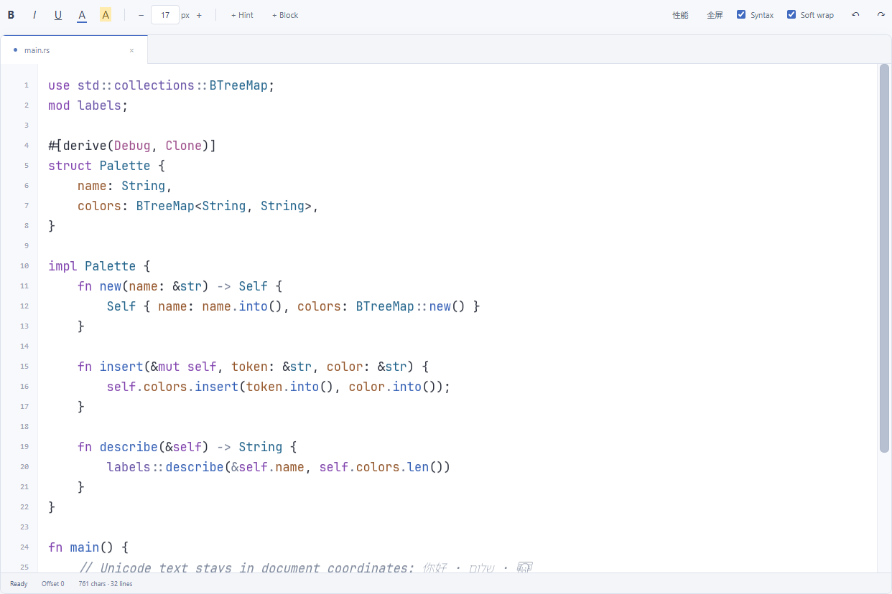

# Texelune

**A framework-independent rich-text and code editor component, built with Rust, WebAssembly and WebGPU.**

Rust owns the document, editing transactions, Unicode navigation, text layout and GPU rendering. The browser component exposes ESM entry points and TypeScript declarations. A layout Worker keeps shaping and glyph preparation off the input path. The included Studio demonstrates rust-analyzer and custom themes.

Status: experimental, pre-1.0. The component is a private workspace distributed from this repository or a locally packed archive.



## Features

- Text replacement, selection, clipboard, composition input, undo/redo and configurable indentation.
- Extended grapheme clusters, font fallback, Arabic shaping, RTL/BiDi visual caret movement and soft wrapping.
- Foreground/background colors, bold, italic, underline, inline hints and block inlays.
- Hover widgets, Ctrl/Meta hover links, definitions, logical-line gutter selection and double-click word selection.
- Edit interception, typed events, keyboard handlers and asynchronous hover/definition/word/indent providers.
- Viewport virtualization, streamed 100MiB fixtures and windowed layout for long ASCII lines.
- Themes, font-size controls, fullscreen, draggable scrollbars and in-editor performance diagnostics.
- An optional LSP adapter for semantic highlights, diagnostics, hover, definitions and completion results.

## Run from a fresh clone

Build tools: Node.js 22+, npm, Rust 1.93.0 and wasm-bindgen CLI 0.2.108. The Rust toolchain and WASM target are declared in `rust-toolchain.toml`.

```sh
git clone https://github.com/komonad/Texelune.git
cd Texelune
npm ci
cargo install wasm-bindgen-cli --version 0.2.108 --locked
npm run build
npm run serve
```

Open <http://127.0.0.1:4173/web/>. The server binds to loopback. Enable the Rust language-service demo with:

```sh
rustup component add rust-analyzer
```

`TEXELUNE_LSP_COMMAND` selects a different executable. The two-instance component example is `/web/component.html`. Generated WASM is excluded from Git; `npm run build` creates `packages/editor/pkg/`.

## Use the component

Direct browser ESM with the development server:

```html
<div id="editor" style="height: 600px"></div>
<script type="module">
  import {createEditor} from '/packages/editor/index.js';
  const editor = await createEditor(document.getElementById('editor'), {
    value: 'fn main() {}', filename: 'main.rs', theme: 'paper',
    autoIndent: 'brackets', indentUnit: '    ',
  });
  const unsubscribe = editor.on('change', ({detail}) => {
    console.log(detail.version, detail.start, detail.end, detail.text);
  });
  // When the host view is disposed:
  // unsubscribe();
  // editor.destroy();
</script>
```

For a separate application, build the repository and install its local archive:

```sh
npm run pack:editor
# From the consuming application's directory:
npm install /absolute/path/to/Texelune/output/texelune-editor-0.3.0.tgz
```

Then import from `texelune-editor`. Serve Workers, WASM, CSS and fonts with their relative module paths intact. See [integration and deployment](docs/integration.md) for assets, browser-only imports and React/Vue lifecycle examples.

## Documentation

| Document | Contents |
| --- | --- |
| [Component guide](packages/editor/README.md) | Entries, setup, themes and language services |
| [JavaScript / TypeScript API](packages/editor/API.md) | Methods, events, offsets, hooks, providers, widgets and cancellation |
| [Integration and deployment](docs/integration.md) | Vanilla, React, Vue, SSR, assets, CSP and disposal |
| [Architecture](docs/architecture.md) | Rust model, Workers, renderer and asynchronous highlighting |
| [Performance and limitations](docs/performance.md) | Metrics, large text, shaping and feature boundaries |
| [Validation](docs/validation.md) | Test coverage and measured scenarios |
| [Typed integration example](examples/component-api.ts) | A strict TypeScript consumer |
| [Contributing](CONTRIBUTING.md) | Development and checks |
| [Third-party notices](THIRD_PARTY_NOTICES.md) | Font and Unicode licenses |

## Contracts

Document offsets are **Unicode scalar indices**; ranges are half-open. `positionAt()` / `offsetAt()` convert zero-based UTF-16 LSP positions. Creation initializes the instance; visible layout arrives asynchronously through `frame` events. `reveal(offset)` ensures visibility without changing selection or focus.

Edit hooks are synchronous main-thread callbacks and must stay lightweight. Async providers receive cancellation signals, have deadlines and discard stale results. Call `destroy()` when disposing the host view; removing the custom element also releases resources.

## Requirements and limitations

Use HTTPS or localhost with WebGPU, WebAssembly, module Workers and `ResizeObserver`. Chromium/Edge have browser regression coverage. Other engines require validation. The component is browser-only, has no Canvas fallback and does not yet provide complete screen-reader support.

100MiB fixtures and long ASCII lines are tested. Arbitrarily long complex Unicode/BiDi paragraphs still need full paragraph shaping. 144Hz is a target, not a guarantee for every document, operation or device. See [performance and limitations](docs/performance.md).

## Layout

```text
packages/editor/       Component, declarations, Workers and fonts
src/                   Rust document, layout, renderer and demo server
web/                   Studio and direct ESM examples
examples/              Typed integration and LSP workspace/fixtures
tests/js/              JavaScript unit tests
tests/browser/         Playwright CLI interaction checks
tests/data/            Unicode conformance fixtures
docs/                  Integration, architecture and validation
scripts/               Build, packaging and repository checks
```

## License

MIT for project source. Fonts retain their included OFL licenses; Unicode fixtures retain Unicode License V3. See [third-party notices](THIRD_PARTY_NOTICES.md).
